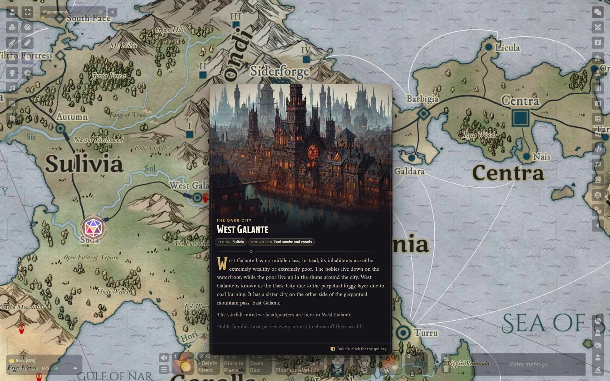
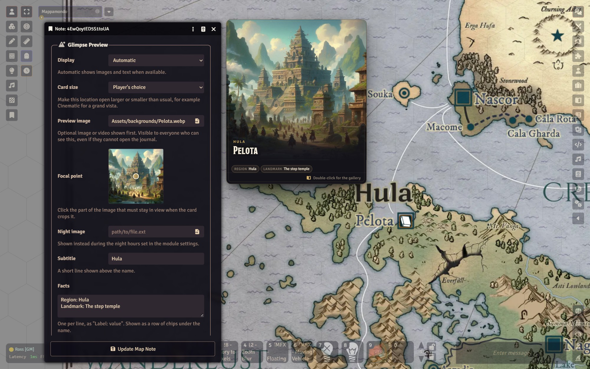
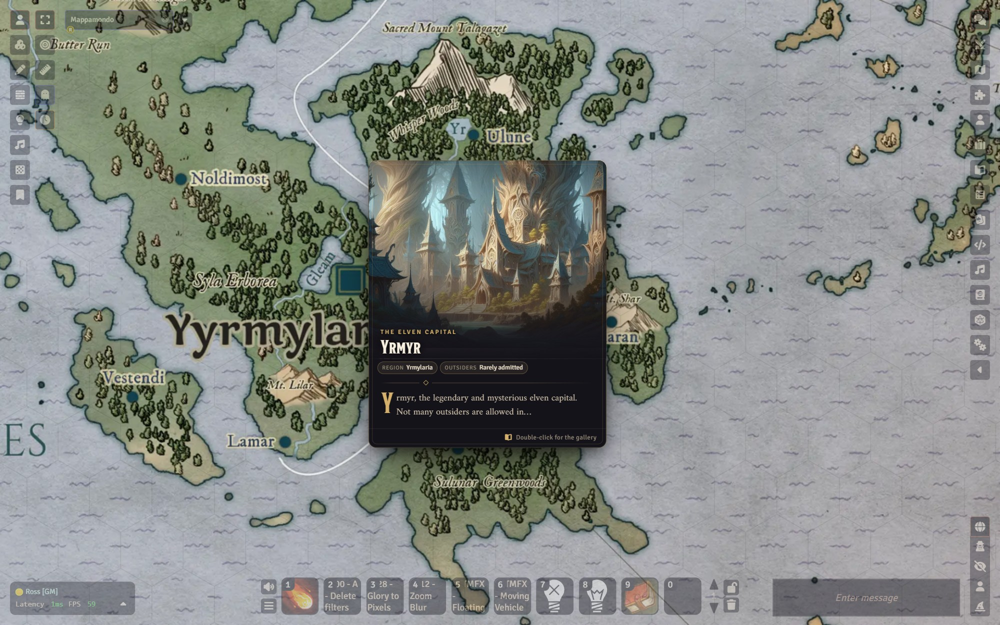
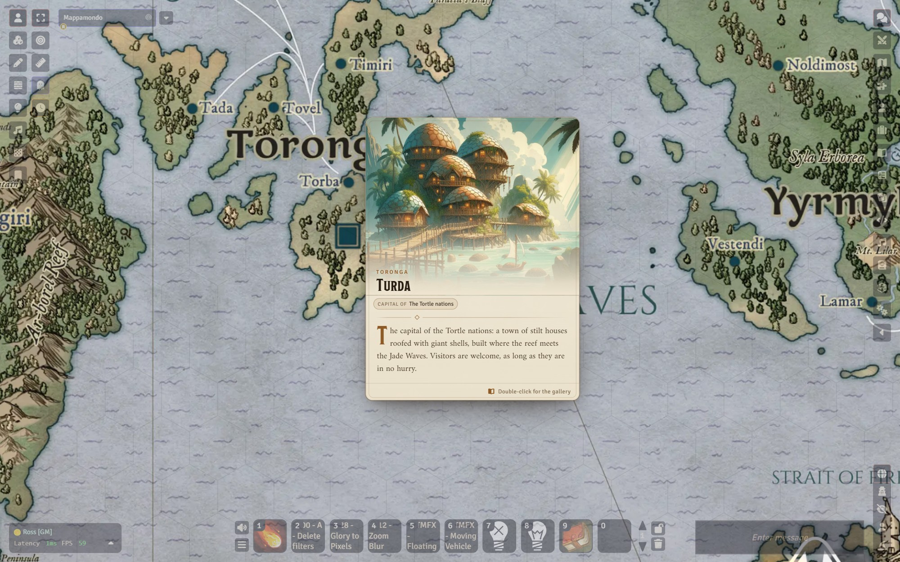
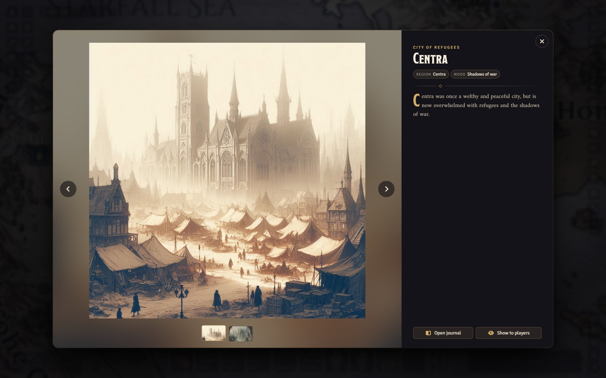
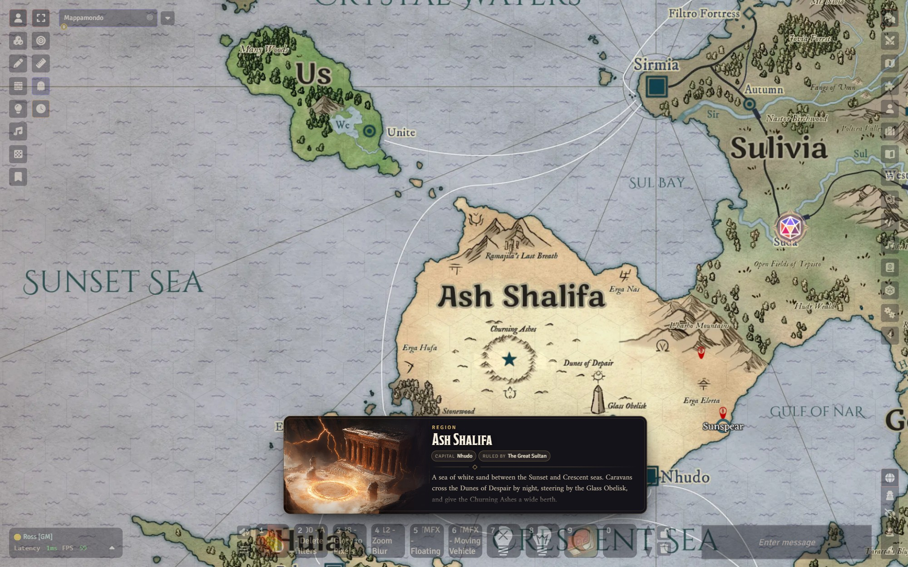
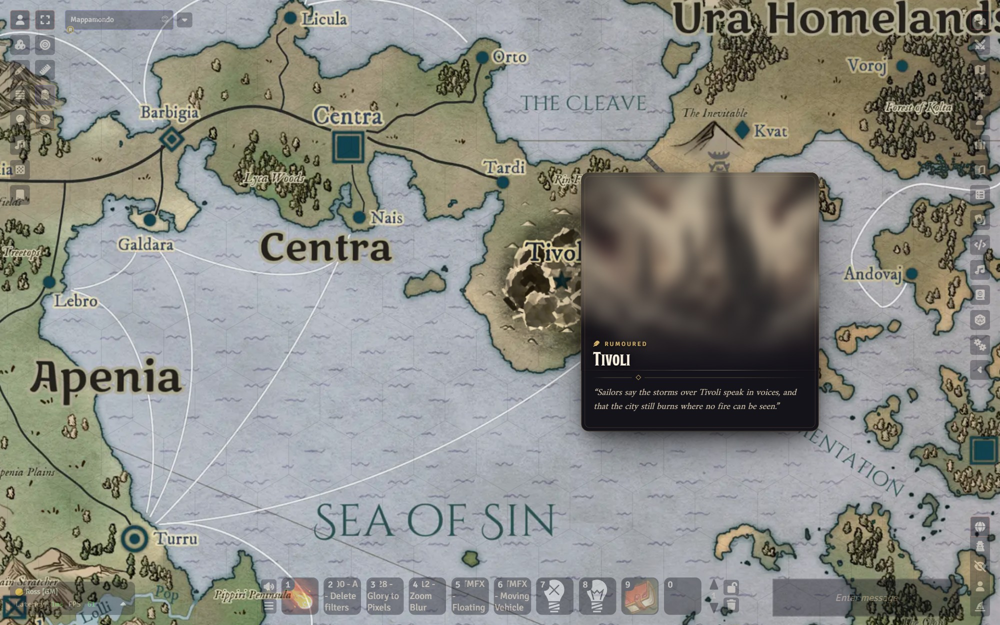

<h1 align="center">Glimpse: Map Note Previews</h1>

<p align="center"><em>Hover a place on the map. See what it looks like, hear what it sounds like, learn what it is.</em></p>

<p align="center">
  
</p>

<p align="center">
  <a href="#installation">Installation</a> ·
  <a href="#setting-up-a-location">Setting up a location</a> ·
  <a href="#features">Features</a> ·
  <a href="#settings">Settings</a> ·
  <a href="#for-system-and-module-developers">Developers</a>
</p>

---

Glimpse turns the map notes of your world into **location cards**. Your players hover a pin and get the mood of the
place at a glance: a painting, its name, a few facts and the opening lines from your journal, without opening a
single window. Double-click for a full-screen gallery, or push a place to every player's screen at the right
dramatic moment.

It is built for worldbuilders: image-first, permission-aware, and happy to read the journals you already have.

**Requires Foundry VTT v14.**

## Installation

In Foundry's **Add-on Modules** tab, choose **Install Module** and paste this manifest URL:

```
https://github.com/reactiveoxygenspecies/glimpse-map-notes/releases/latest/download/module.json
```

Then enable **Glimpse: Map Note Previews** in your world.

## Setting up a location

Glimpse works with the journals you already have: hover any map note and it builds a card from the linked journal.
For the richest cards:

1. Give the journal entry one or more **image pages** for the mood, and a **text page** for the description.
   Images pasted inside text pages are picked up too.
2. Link a map note to the journal entry. Link it to a single **page** to show just that page.
3. Give players at least **Limited** permission to see images, or **Observer** to also read the text.

Every note's configuration gets a **Glimpse Preview** section to fine-tune the card, with a live preview of your
unsaved changes:

<p align="center">
  
</p>

| Field | What it does |
| --- | --- |
| **Display** | Automatic, image and text, image only, text only, or no preview |
| **Card size** | Use the player's preferred size, or force small, medium, large or cinematic for this place |
| **Preview image** | An image or video shown first. Works even when the note has no journal |
| **Focal point** | Click the part of the image that must never be cropped away |
| **Night image** | Replaces the preview image during the night hours you set |
| **Subtitle** | A short line above the name, such as *The Dark City* |
| **Facts** | One `Label: value` per line, shown as chips under the name |
| **Ambient sound** | A quiet loop that plays while the card is open |
| **Discovery** | Known to everyone, rumoured until you mark it discovered, or rumoured until explored |

Image pages also get a **focal point** and a **night image** when you edit them.

## Features

### Location cards

<table>
  <tr>
    <td width="50%"></td>
    <td width="50%"></td>
  </tr>
  <tr>
    <td align="center"><em>Dusk style</em></td>
    <td align="center"><em>Parchment style</em></td>
  </tr>
</table>

- Images first, then the name, a subtitle, facts and an excerpt from the journal, with a drop cap and captions.
- Several images cross-fade slowly into one another while the card is open.
- Cards follow the map as you pan and zoom, flip to whichever side has room, and never leave the screen.
- Hovering a note in the v14 **Notes** sidebar list shows its card beside the list.

### The gallery

<p align="center">
  
</p>

Double-click a note to see its images full screen, with thumbnails, the full description and a button to open the
journal. Arrow keys flip through the images and <kbd>Esc</kbd> closes it.

### Show to players

The GM can push a location to every connected player as a full-screen reveal: from the gallery, from the right-click
menu in the Notes sidebar, or with a keybinding while hovering a note. Players close it themselves, or the GM closes it
for everyone. Showing a rumoured place marks it as discovered.

### Region banners

<p align="center">
  
</p>

Give a v14 **Region** its own Glimpse from the new tab in its configuration. When a player's pointer rests inside the
region, a wide banner appears above the hotbar: perfect for setting the mood of a whole forest, coast or kingdom.
Players can choose to see banners on hover, only while holding <kbd>G</kbd>, or never.

### Rumours and discovery

<p align="center">
  
</p>

Mark a place as rumoured and players see only a veiled image and the rumour you wrote. It opens up when you mark it
discovered, when you show it to them, or, if you prefer, when they uncover it through fog of war. The GM always sees
the full card, with a small reminder of what players see.

### Atmosphere

- **Day and night images** swap automatically with the world clock.
- **Ambient sound** plays a quiet loop while a card or the gallery is open, at each player's chosen volume.
- **Travel distance** shows how far the place is from your selected token, and roughly how many days away.
- **Focal points** keep the castle in frame however the card crops the image.

## Permissions

Glimpse never shows more than double-clicking the note would. Text needs **Observer** permission on the page; image
pages need **Limited**, the same as core Foundry. Secret blocks are hidden, even from owners, unless the owner turns on
**Show secrets to owners**. Fields stored on the note or region itself (preview image, subtitle, facts) are visible to
anyone who can see it. When the GM shows a location to players, they see what the GM sees, minus secrets.

## Settings

**Per player**

| Setting | Default |
| --- | --- |
| Show location previews | On |
| Card style (Dusk, Parchment, or match the interface) | Dusk |
| Card size (small, medium, large, cinematic) | Medium |
| Text excerpt (none, short, medium, long) | Medium |
| Text size, hover delay | 100%, 200 ms |
| Region banners (on hover, while holding <kbd>G</kbd>, never) | On hover |
| Cycle through images | On |
| Slow pan on images | Off |
| Ambient sound volume | 40% |
| Show travel distance, hide the note's label while previewing | On |
| Show secrets to owners | Off |

**World (GM only):** what double-clicking a note opens (gallery or journal), travel per day, and the in-game hours
when night begins and ends.

**Keybindings:** toggle previews, show the hovered location to players (GM), and peek at regions (<kbd>G</kbd>).

## Works with your game system

Glimpse reads core text, image and video pages, and also understands the journal page types that game systems add.
For those it looks for player-facing text (such as an overview or description) and artwork (such as a banner image),
and never reads GM-only fields.

## For system and module developers

`game.modules.get("glimpse-map-notes").api` is available once the `glimpseReady` hook fires:

| Member | Purpose |
| --- | --- |
| `show(note)`, `hide()`, `refresh()` | Control the hover card |
| `openGallery(doc)` | Open the gallery for a note or region |
| `reveal(doc)` | Show a note or region to every player (GM only) |
| `toggle(value)` | Turn previews on or off for this client |
| `registerPageReader(type, reader)` | Teach Glimpse to read your own page type |

A page reader receives a `JournalEntryPage` and returns what to show:

```js
Hooks.once("glimpseReady", api => {
  api.registerPageReader("mysystem.location", page => ({
    html: page.system.description,      // Player-facing HTML
    image: page.system.artwork,         // Image or video path
    caption: page.system.artworkCaption
  }));
});
```

## Credits

Glimpse was inspired by *Map Note Hover Display* by FriendlyLambda, which in turn built on
[Pin Cushion](https://github.com/death-save/pin-cushion) by Death Save Development.

Screenshots show the world of Fama, a homebrew campaign setting by the author. Its map, art and text are not part of
the module.

Glimpse is released under the [MIT License](LICENSE).
